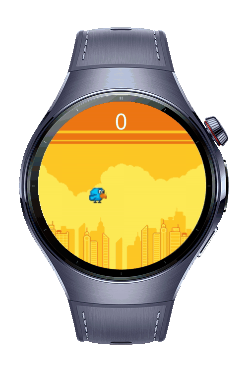
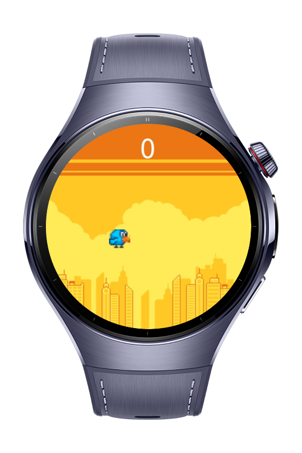
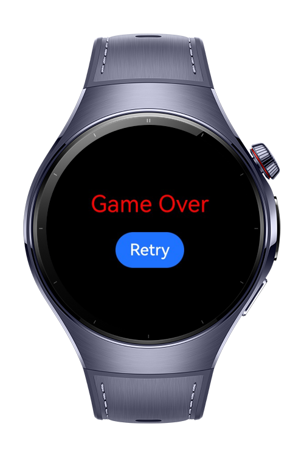

> **Note:** To access all shared projects, get information about environment setup, and view other guides, please visit [Explore-In-HMOS-Wearable Index](https://github.com/Explore-In-HMOS-Wearable/hmos-index).

# Bird Game

A Bird-inspired mini game built for HarmonyOS NEXT wearable devices, developed using ArkTS.
The game features auto-scrolling pipes, tap-to-flap mechanics, random pipe height and real-time score tracking.

# Preview

<div>
  
  
  
</div>

# Use Cases

- **Wearable Entertainment**: Provide a quick, enjoyable gaming experience on smartwatches.
- **Wearable Audio usage**: The app also provide a simple audio usage on the smartwatches.

# Tech Stack

- **Language**: ArkTS
- **Framework**: HarmonyOS NEXT
- **Tools**: DevEco Studio 5.1.0.849

# Directory Structure

```
entry/src/main/ets/
├── common/
│ └── Types.ets // Game state enums and Pipe interface
│
├── components/
│ ├── Bird.ets // Animated bird with sprite frames
│ ├── Pipe.ets // Renders upper/lower pipe views
│ └── Ground.ets // Handles scrolling ground layer
│
├── pages/
│ ├── GamePage.ets // Core gameplay logic and layout
│ └── GameOverPage.ets // Game over layout placeholder
│
├── services/
│ ├── GameService.ets // Physics, scoring, and game loop logic
│ └── AudioService.ets // Sound playback using AVPlayer
│
├── resources/
│ └── media/ // Sprite PNGs and audio (wav/mp3) files
│
└── module.json5 // Metadata and device compatibility
```

# Constraints and Restrictions

## Suported Devices

- Huawei Watch 5

## Operation Guide

1. Clone the repository into DevEco Studio.
2. Make sure you are using **DevEco Studio 5.1.0+**
3. Connect a Huawei smartwatch (Watch 5 or equivalent).
4. Build and deploy to the wearable device.
5. Tap anywhere on the screen to flap the bird and start playing.

# License

**Harmony Bird** is distributed under the terms of the MIT License
See the [license](./LICENSE) for more information.

## Creative Commons Assets Used

The images/musics used in this project are shared under the Creative Commons and MIT
license.

- License: [CC BY 4.0](https://creativecommons.org/licenses/by/4.0/)
- Source: [images](https://megacrash.itch.io/flappy-bird-assets#google_vignette)
- Source: [musics](https://github.com/samuelcust/flappy-bird-assets/blob/master/LICENSE)