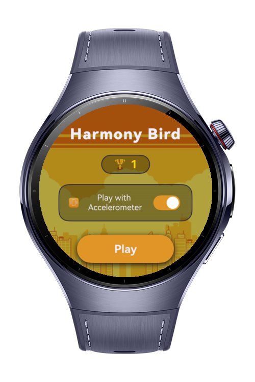
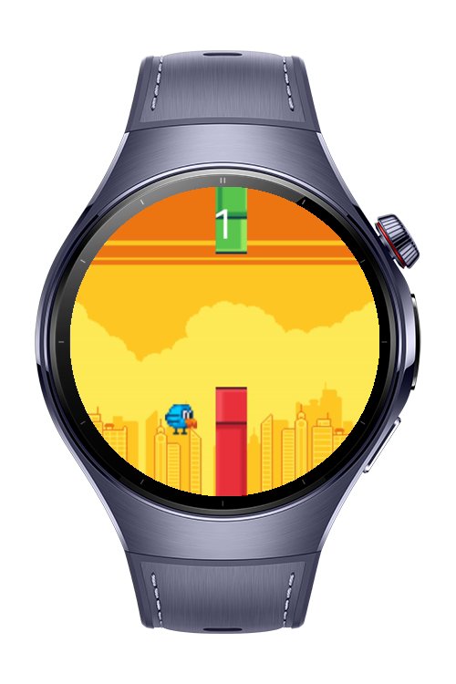
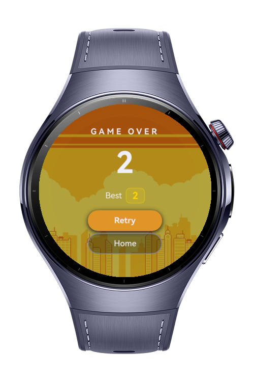

# Bird Game

A Flappy Bird-inspired mini game built for HarmonyOS NEXT wearable devices, developed using ArkTS.
The game features auto-scrolling pipes, multiple input methods, persistent high score tracking, and a polished wearable-native UI.

# Preview

<div>
  
  
  
</div>

# Use Cases

- **Three Input Methods**: Tap the screen, rotate the Digital Crown, or tilt your wrist forward to flap the bird
- **Persistent High Score**: Best score is saved locally using ArkData Preferences and survives app restarts
- **New Record Detection**: Animated trophy screen with gold glow effect when a new high score is set
- **Haptic Feedback**: Short vibration on every flap via Basic Services Kit
- **Home Screen**: Toggle wrist gesture input on/off before starting the game
- **Screen Always On**: Display stays active during gameplay using Window Kit

# Technology

## Stack
**Languages**: ArkTS, ArkUI

**Frameworks**: HarmonyOS SDK 5.1.0(18)

**Tools**: DevEco Studio Vers 5.1.0.842

**Libraries**: `@kit.AbilityKit`, `@kit.ArkUI`, `@kit.ArkData`, `@kit.SensorServiceKit`, `@kit.BasicServicesKit`, `@kit.MediaKit`, `@kit.AudioKit`

## Required Permissions
* `"ohos.permission.ACCELEROMETER"`
* `"ohos.permission.VIBRATE"`

# Directory Structure

```
entry/src/main/ets/
├── common/
│   ├── GlobalContext.ets     // Singleton UIAbilityContext holder
│   ├── Pages.ets            // Page name constants
│   └── Types.ets            // GameState enum, Pipe interface, param types
│
├── components/
│   ├── Bird.ets             // Animated bird with sprite frames
│   └── Pipe.ets             // Renders upper/lower pipe pair
│
├── pages/
│   ├── HomePage.ets         // Start screen with high score and accel toggle
│   ├── GamePage.ets         // UI layer — renders game state from ViewModel
│   └── GameOverPage.ets     // Score display, new record animation, retry/home
│
├── services/
│   ├── GameService.ets      // Physics engine — birdY, velocity, pipes, scoring
│   ├── AudioService.ets     // Sound playback using AVPlayer
│   └── ScoreService.ets     // High score read/write via ArkData Preferences
│
├── viewmodels/
│   └── GameViewModel.ets    // Game loop, collision, input (tap/crown/accel), game over
│
├── resources/
│   ├── base/element/
│   │   ├── color.json       // All UI colors
│   │   └── string.json      // All UI strings (EN)
│   └── media/               // Sprite PNGs and audio (wav/mp3) files
│
└── module.json5             // Metadata and device compatibility
```

# Constraints and Restrictions

## Suported Devices

- Huawei Watch 5

# License

**Harmony Bird** is distributed under the terms of the MIT License
See the [license](./LICENSE) for more information.

## Creative Commons Assets Used

The images/musics used in this project are shared under the Creative Commons and MIT
license.

- License: [CC BY 4.0](https://creativecommons.org/licenses/by/4.0/)
- Source: [images](https://megacrash.itch.io/flappy-bird-assets#google_vignette)
- Source: [musics](https://github.com/samuelcust/flappy-bird-assets/blob/master/LICENSE)